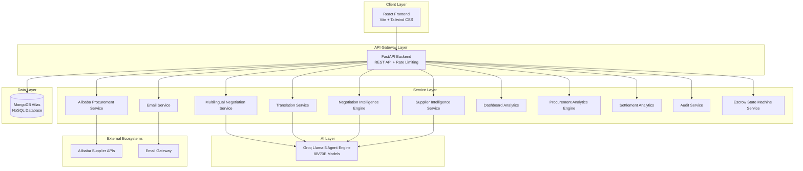
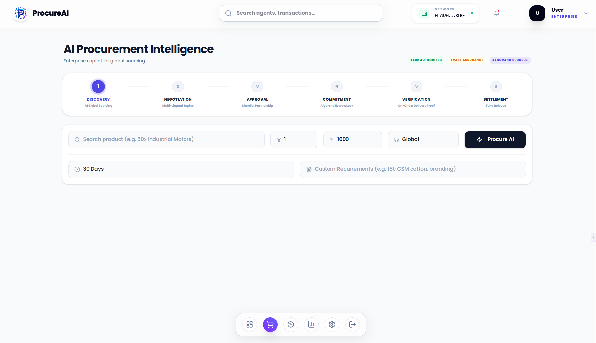
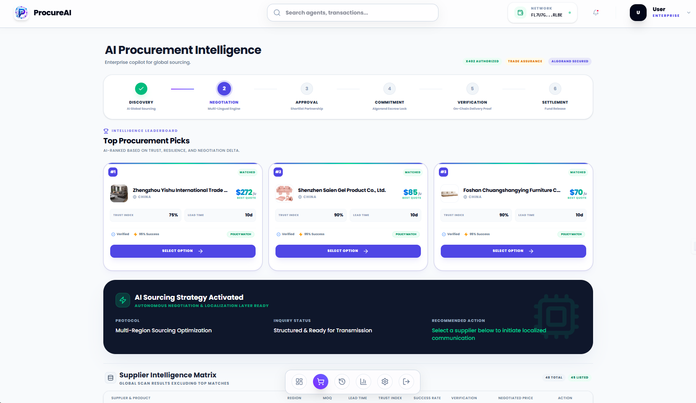
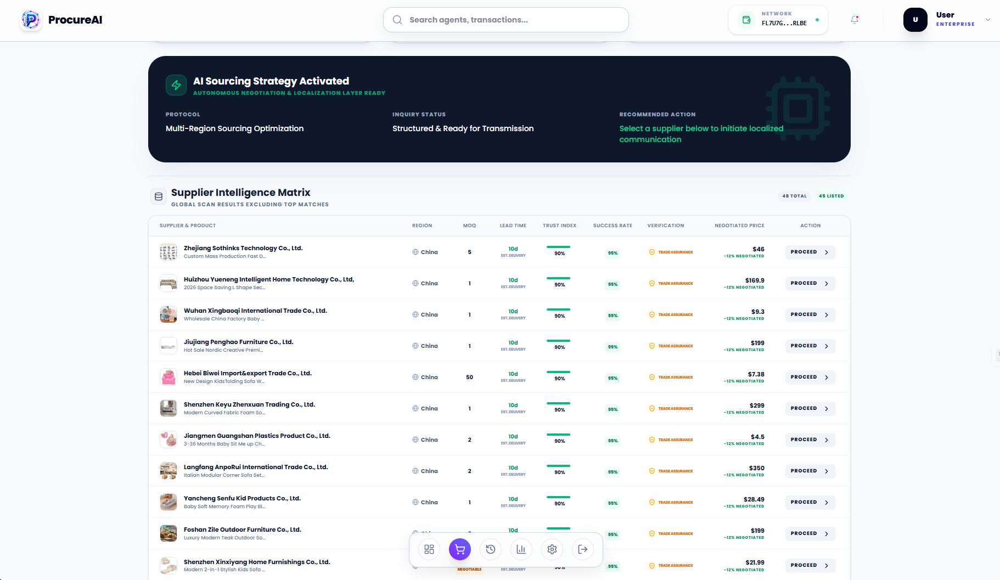
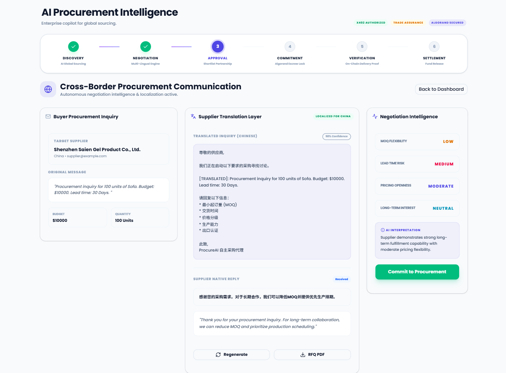
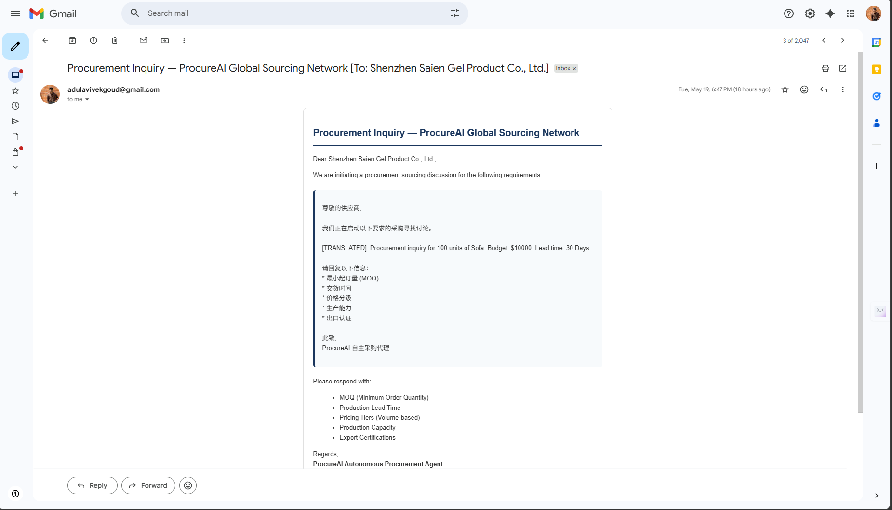

# ProcureAI: AI Procurement Intelligence Platform

An AI-powered procurement platform with supplier intelligence, multilingual negotiation, and secure milestone-based escrow.

> Extended from an earlier ProcureAI prototype for BUILD 2036.

[](https://opensource.org/licenses/MIT)
[](https://www.python.org/)
[](https://reactjs.org/)

---

## What is ProcureAI?

ProcureAI is an AI platform that helps businesses find and work with suppliers globally and domestically. It sits on top of supplier ecosystems and adds intelligence to the procurement process.

The platform helps you:

- Find suppliers worldwide and domestically
- Generate procurement requests with AI
- Communicate in multiple languages
- Analyze negotiations and counter-offers
- Rank suppliers by reliability and performance
- Secure commitments through escrow with verified delivery

Each feature works as a modular service that can be used independently.

---

## Why use ProcureAI?

Most procurement work is still done manually:

- Comparing suppliers by hand
- Scattered communication channels
- Using manual translation tools
- Managing disparate spreadsheets
- Coordinating multiple stakeholders
- Slow negotiation cycles

ProcureAI automates supplier discovery, negotiations, and analysis. It turns manual procurement into an AI-assisted process.

---

## System Architecture

ProcureAI uses a modular system with reusable agents and a simulated escrow engine:



---

## Procurement Agents

ProcureAI uses these modular agents and services:

| Agent                          | Capability                                           |
| ------------------------------ | ---------------------------------------------------- |
| Supplier Discovery Agent       | Fetches suppliers from ecosystems                    |
| Translation Agent              | Localizes procurement communication                  |
| Procurement Inquiry Agent      | Generates AI-powered RFQs                            |
| Negotiation Intelligence Agent | Extracts MOQ & pricing flexibility                   |
| Supplier Ranking Agent         | Ranks suppliers using trust & fulfillment scoring    |
| Escrow Commitment Service      | Coordinates milestone-based commitment & settlement  |
| Verification Service           | Handles delivery verification workflows              |

---

## How It Works

Here is how the procurement workflow works:

### 1. Submit Requirements

Enter what you need:
- Product details
- Quantity
- Budget
- Delivery date
- Location
- Custom requirements

The system structures your request and starts finding suppliers.



### 2. Find and Rank Suppliers

The system searches supplier databases and ranks them by:
- Trust score
- Delivery reliability
- Price flexibility
- Minimum order requirements
- Verification status

It shows you the best matches.



Below is the extended supplier scanning matrix generated by the agent:



### 3. Communicate with Suppliers

The system translates your requests into the supplier's language.

It analyzes supplier responses for:
- Minimum order flexibility
- Price negotiation room
- Delivery reliability
- Long-term partnership interest

Responses are translated back to English.



### 4. Send Inquiries

The system sends your requests to suppliers in their language.

This shows:
- Automated procurement
- Real supplier communication
- AI-generated requests
- Multilingual sourcing



## Workflow Summary

The complete process:

1. Create procurement request
2. Find suppliers globally and domestically
3. Rank suppliers with AI
4. Communicate in multiple languages
5. Analyze negotiations
6. Secure payment with escrow
7. Verify delivery
8. Complete settlement release

---

## Escrow & Settlement

Escrow is currently simulated with a state machine and audit log. Payment-gateway integration is in progress.

- Status lifecycle: `CREATED` &rarr; `FUNDED` &rarr; `PROOF_UPLOADED` &rarr; `VERIFIED` &rarr; `RELEASED` (with `CANCELLED` and `REFUNDED` support).
- Funds are held in escrow and released only after verified delivery.
- All state transitions are logged with timestamps, actors, and notes in an immutable audit trail.

---

## Key Features

### 1. Agent-Based Commerce
AI agents handle negotiations and supplier scoring automatically, speeding up procurement from days to minutes.

### 2. AI Negotiation Engine
Uses advanced language models to make counter-offers and evaluate trade-offs based on your business rules.

### 3. Milestone-Based Escrow
Escrow holds funds securely until proof of delivery is verified, protecting both buyers and suppliers.

---

## Technology Stack

| Layer | Technology |
| :--- | :--- |
| **User Interface** | React 18, Vite, Tailwind CSS, Lucide Icons |
| **API** | FastAPI (Python 3.9+) |
| **Escrow Service** | Simulated State Machine with MongoDB Audit Trail |
| **AI** | Groq, Llama 3 |
| **Database** | MongoDB Atlas |

---

## Project Structure

```
frontend/       React frontend (Vite + Tailwind)
backend/        FastAPI backend
├── ai/         AI agent scoring and competition
├── database/   MongoDB database connections and models
├── services/   Procurement, negotiation, translation, email, and escrow services
tests/          Pytest test suite
docs/           Documentation
```

---

## Setup

### 1. Backend
```bash
python -m venv venv
pip install -r backend/requirements.txt
cd backend
python -m uvicorn main:app --reload
```

### 2. Frontend
```bash
cd frontend
npm install
npm run dev
```

---

## License
MIT License - see LICENSE file for details.

---

ProcureAI - AI-powered procurement platform.
