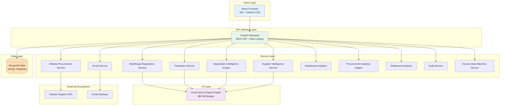
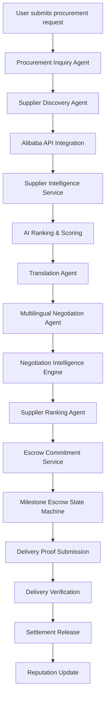

# ProcureAI Architecture Documentation

## System Architecture

## Component Architecture

### 1. Frontend Layer (React + Vite)

**Technology Stack:**
- React 18 with TypeScript
- Vite for build tooling
- Tailwind CSS v4 for styling
- React Router for navigation
- Lucide Icons for UI iconography
- Recharts for data visualization
- Framer Motion for animations

**Key Pages & Components:**
- `Dashboard.tsx` - Main procurement dashboard
- `Procurement.tsx` - AI-powered procurement workflows with milestone escrow status
- `Analytics.tsx` - Advanced analytics and reporting
- `Transactions.tsx` - Escrow transaction tracking
- `Admin.tsx` - Administrative controls and audit logs
- `Settings.tsx` - User and notification configuration
- `LiveDealArena.tsx` - Real-time negotiation visualization

### 2. Backend API Layer (FastAPI)

**Technology Stack:**
- FastAPI 0.135.1 with async support
- Uvicorn ASGI server
- Pydantic for data validation
- JWT authentication with bcrypt
- Rate limiting with slowapi
- CORS middleware for frontend integration

**Core Services:**

#### AI & Intelligence Services
- `ai_agent.py` - AI agent orchestration and supplier selection
- `alibaba_procurement_service.py` - Alibaba API integration
- `multilingual_negotiation_service.py` - Cross-border negotiation
- `translation_service.py` - Multi-language support
- `negotiation_intelligence.py` - MOQ & pricing analysis
- `supplier_intelligence_service.py` - Supplier ranking
- `llm_service.py` - Reusable LLM helper via Groq

#### Analytics & Reporting
- `dashboard_analytics.py` - Real-time dashboard metrics
- `procurement_analytics_engine.py` - Advanced analytics
- `procurement_insights.py` - Business intelligence
- `settlement_analytics.py` - Settlement tracking

#### Communication & Operations
- `email_service.py` - Email notifications with dry-run mode
- `procurement_message_engine.py` - Message orchestration
- `audit_service.py` - Audit logging
- `escrow_service.py` - Milestone-based escrow state machine

### 3. Escrow State Machine Service

**Lifecycle:**
- `CREATED`: Escrow record initialized with buyer, supplier, and INR amount.
- `FUNDED`: Commitment funded.
- `PROOF_UPLOADED`: Supplier uploads delivery proof (invoice file or tracking code).
- `VERIFIED`: Buyer verifies delivery proof.
- `RELEASED`: Settlement funds released to supplier.
- `CANCELLED` / `REFUNDED`: Terminal dispute/cancellation states.

Invalid state transitions return HTTP 409 Conflict. All transitions are logged with timestamps, actors, and notes in MongoDB.

### 4. Database Layer (MongoDB Atlas)

**Collections:**
- `users` - Authentication & user profiles
- `escrows` - Escrow state machine records & transition histories
- `suppliers` - Supplier registry and cached intelligence
- `procurement_transactions` - Transaction records
- `supplier_ratings` - Reputation and reviews
- `audit_logs` - Immutable audit trail

## Data Flow

### Procurement Workflow

## Security Features

- Strict JWT authentication (raises runtime error if secret is missing)
- Rate limiting with slowapi
- Strict CORS configuration
- Password hashing with bcrypt
- Audit logging for all sensitive actions and state transitions
