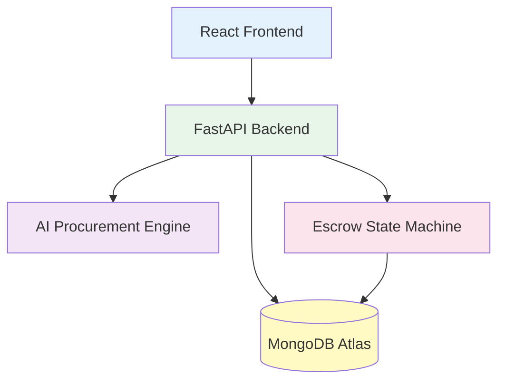
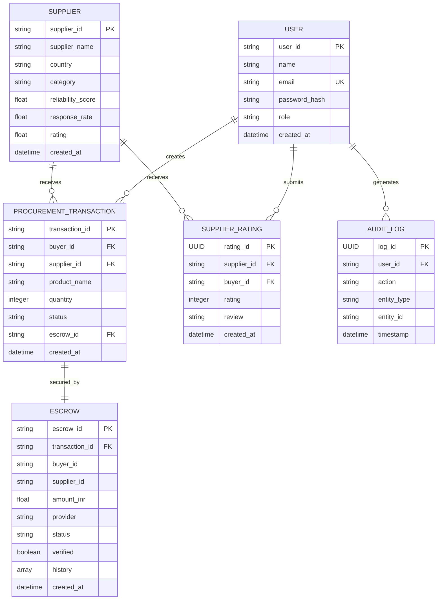

# ProcureAI Database Design

---

## Architecture Context

ProcureAI uses MongoDB Atlas as the database. It connects to multiple service layers:



---

## Section 1: Database Overview

ProcureAI uses MongoDB Atlas as its primary database, providing a flexible NoSQL schema that scales with the platform's growth. The database stores user authentication records, supplier registry entries, procurement transactions, simulated escrow lifecycles with full audit logs, and supplier ratings.

---

## Section 2: Collection Schema Definitions

### User

```json
{
  "_id": "ObjectId",
  "user_id": "UUID (Primary Key)",
  "name": "String",
  "email": "String (Unique)",
  "password_hash": "String (bcrypt)",
  "role": "String (buyer/supplier/admin)",
  "created_at": "DateTime"
}
```

### Supplier

```json
{
  "_id": "ObjectId",
  "supplier_id": "String (Primary Key)",
  "supplier_name": "String",
  "country": "String",
  "category": "String",
  "reliability_score": "Float (0-100)",
  "response_rate": "Float (0-100)",
  "rating": "Float (0-5)",
  "created_at": "DateTime"
}
```

### ProcurementTransaction

```json
{
  "_id": "ObjectId",
  "transaction_id": "String (Primary Key)",
  "buyer_id": "String (Foreign Key -> users)",
  "supplier_id": "String (Foreign Key -> suppliers)",
  "product_name": "String",
  "quantity": "Integer",
  "status": "String (draft/negotiating/confirmed/in_transit/completed/cancelled)",
  "escrow_id": "String (Foreign Key -> escrows)",
  "created_at": "DateTime"
}
```

### Escrow

```json
{
  "_id": "ObjectId",
  "escrow_id": "String (Primary Key)",
  "transaction_id": "String (Unique)",
  "buyer_id": "String",
  "supplier_id": "String",
  "amount_inr": "Float",
  "provider": "simulated",
  "status": "String (CREATED/FUNDED/PROOF_UPLOADED/VERIFIED/RELEASED/CANCELLED/REFUNDED)",
  "promised_delivery_days": "Integer",
  "verified": "Boolean",
  "delivery_proof": "Object (type, value, file_path, submitted_at)",
  "history": [
    {
      "status": "String",
      "timestamp": "ISO DateTime",
      "actor": "String",
      "note": "String"
    }
  ],
  "created_at": "DateTime",
  "updated_at": "DateTime"
}
```

### SupplierRating

```json
{
  "_id": "ObjectId",
  "rating_id": "UUID (Primary Key)",
  "supplier_id": "String (Foreign Key -> suppliers)",
  "buyer_id": "String (Foreign Key -> users)",
  "rating": "Integer (1-5)",
  "review": "String",
  "created_at": "DateTime"
}
```

### AuditLog

```json
{
  "_id": "ObjectId",
  "log_id": "UUID (Primary Key)",
  "user_id": "String (Foreign Key -> users)",
  "action": "String",
  "module": "String",
  "entity_type": "String",
  "entity_id": "String",
  "details": "Object",
  "timestamp": "DateTime"
}
```

---

## Section 3: Collection Relationship Diagram



---

## Section 4: Scalability Notes

### MongoDB Indexing Strategy
- **Unique Indexes**: `users.email`, `escrows.transaction_id`, `escrows.escrow_id`
- **Compound Indexes**: `procurement_transactions.buyer_id + status`, `escrows.status + updated_at`
- **TTL Indexes**: `audit_logs.timestamp` for automatic retention

### Escrow State Machine Storage
- Escrow records contain an audit `history` array recording every transition, timestamp, actor, and note.
- Future payment gateway integrations (e.g. Razorpay / Cashfree test mode) will populate `provider_reference_id` alongside the simulated state machine.
